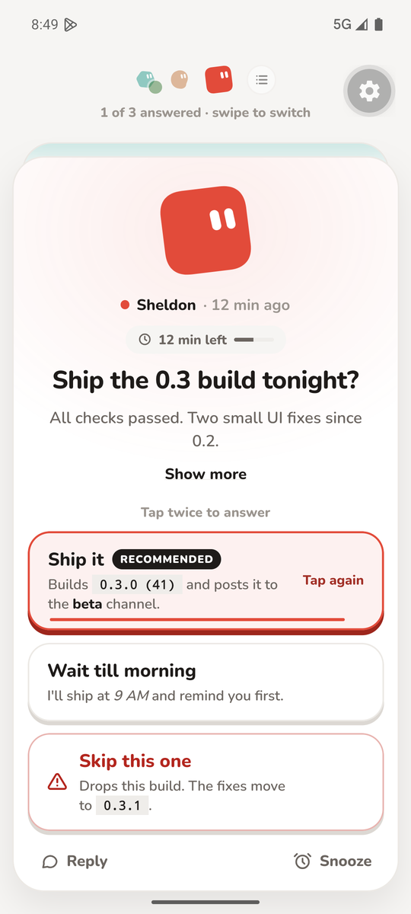
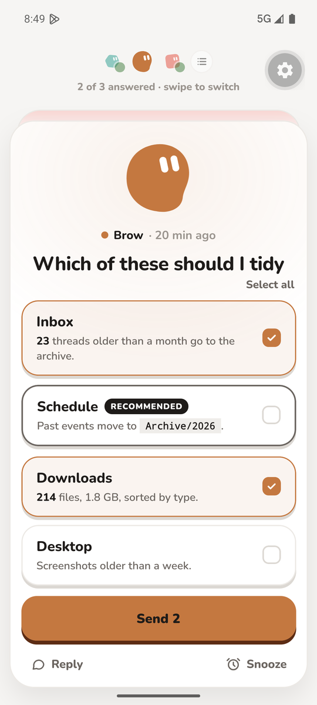
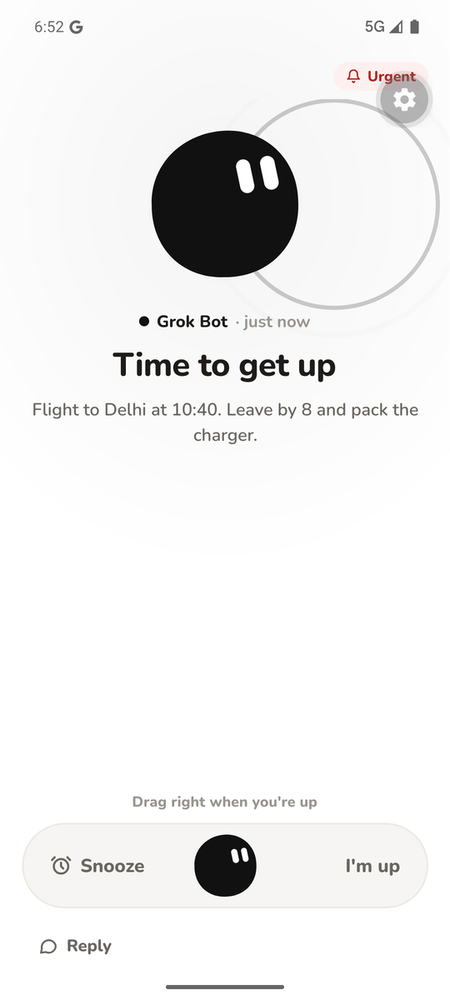

# Puck

[](https://github.com/ZeshanGIT/puck/actions/workflows/ci.yml)

Puck is a pager for AI agents: an agent sends an alert, your phone rings with a full-screen, call-style notification, and your reply goes back to the agent.

<p>
  
  
  
</p>

*Pick one (tap twice to send), pick several, and an urgent wake-up alarm you drag to answer. Screenshots from a development build on an Android emulator.*

## How it works

1. An agent pages you with the `puck` CLI or the HTTP API. The call returns at once with a question id.
2. Your Android phone shows a full-screen, call-style alert in the bot's colour, over the lock screen when it is urgent.
3. You answer deliberately: tap an option twice, check several and send, drag the bot past a line, or type a reply.
4. Puck posts the answer to that bot's own webhook, with stable option ids it can act on, and shows you when it was delivered.

Every bot pairs with a six-digit code you approve on the phone, and has its own key in each direction.

## Status

A personal project in active development, used daily on one Pixel 7. Android only for now, with no store build: releases are debug-signed and point at a development backend. iPhone, spoken alarms and a hosted version are not built.

## Layout

A TypeScript monorepo managed with [Bun workspaces](https://bun.sh/docs/install/workspaces):

- `app/` (`@puck/app`) - mobile app in React Native with Expo (Android first)
- `backend/` (`@puck/backend`) - Convex backend: database and HTTP endpoints; Firebase Cloud Messaging is used only for push
- `cli/` (`@puck/cli`) - `puck` CLI in TypeScript (Commander, compiled to a single executable with `bun build --compile`)
- `packages/shared/` (`@puck/shared`) - alert and reply types shared by the app, backend and CLI
- `tsconfig.base.json` - shared compiler options for `cli/` and `packages/shared/` (the app uses Expo's base config, the backend Convex's)

## Requirements

- [Bun](https://bun.sh) 1.4 or newer: `curl -fsSL https://bun.sh/install | bash`
- Node.js 22.13 or newer (LTS), needed by the Expo CLI
- For the app on Android: a development build (not Expo Go), the Android SDK, and JDK 17 for local Gradle builds

## Setup

```sh
bun install          # from the repo root; installs every workspace. Needs Bun 1.4 or newer (the lockfile version).
bun run typecheck    # typechecks all workspaces
bun test             # unit tests for hashing, validation and the answer payload
```

## App (`app/`)

The app needs a **development build** (not Expo Go) because full-screen alerts will use native modules such as Notifee later. Phase 1 adds `expo-dev-client` and the Android application id `in.puckit.app`.

### Requirements on your machine

- Node.js 22.13 or newer (LTS)
- Android SDK at `$HOME/Library/Android/sdk` (Android Studio)
- JDK 17 for Gradle (the app `start` script exports `JAVA_HOME` from `/usr/libexec/java_home -v 17`; it does not change your system Java default)

### Local Android build (no device required)

From the repo root:

```sh
~/.bun/bin/bun install
cd app
~/.bun/bin/bunx expo prebuild --platform android --no-install
export JAVA_HOME="$(/usr/libexec/java_home -v 17)"
export ANDROID_HOME="$HOME/Library/Android/sdk"
cd android
./gradlew :app:assembleDebug
```

Prebuild writes `app/android/` locally (gitignored). A successful `assembleDebug` produces a debug APK under `app/android/app/build/outputs/apk/debug/`.

### Release APK on the Pixel 7 (one command)

Connect the Pixel 7 over wireless debugging or USB, unlock it, and accept the debugging prompt. Then, from the repo root:

```sh
bun run release:install
```

The script checks JDK 17, the Android SDK and the phone before it builds. Then it:

1. runs `expo prebuild` for Android, which regenerates `app/android` from `app.json` and the config plugins;
2. runs `./gradlew :app:assembleRelease -PreactNativeArchitectures=arm64-v8a`, with R8 on and the JavaScript bundle embedded;
3. checks the APK: the package name, not debuggable, the bundle present, and the WorkManager keep rules in the R8 mapping;
4. runs `adb install -r` on the phone, which keeps the app's data, and prints the package metadata.

It does not launch the app or change device settings.

Options (after `--`):

- `bun run release:install -- --serial <serial>` picks the phone when more than one is connected. `PUCK_ADB_SERIAL` does the same. Find serials with `adb devices -l`.
- `bun run release:install -- --dry-run` checks everything and prints the plan. Nothing is built or installed.
- `bun run release:install -- --skip-build` installs the APK already built.
- `PUCK_DEVICE_MODEL` sets the expected model (default `Pixel 7`); set it to an empty string to skip the check.

Safety: emulators are refused. A phone that is not authorized, or several phones without `--serial`, stop the script with a message. The phone's model must match. Install is `adb install -r` only: no uninstall, no data clear, no downgrade. If the signing key differs from the installed app, install fails and nothing is removed.

Requirements: JDK 17 (`/usr/libexec/java_home -v 17` on macOS, or `JAVA_HOME`), the Android SDK (`ANDROID_HOME`, default `~/Library/Android/sdk` on macOS), Node 22.13 or newer, and `unzip`. The release is signed with the debug keystore and points at the dev Convex and Clerk instances, so it is not a store build.

### Run on a device or emulator (development build)

When you have a connected device or a working emulator:

```sh
cd app
~/.bun/bin/bun run android
```

The `start` and `android` scripts export `JAVA_HOME` and `ANDROID_HOME` before calling Expo. With the dev client installed, `~/.bun/bin/bun run start` runs Metro for JavaScript hot reload.

Add native-compatible packages with `bunx expo install <package>` so versions match the Expo SDK. Metro resolves workspace packages such as `@puck/shared` automatically; no custom Metro config is needed.

## Backend (`backend/`)

The Convex project stores bots, alerts and answers (`convex/schema.ts`) and serves `GET /health`, `POST /alerts` and `GET /alerts/<questionId>`. The dev deployment is `usable-mule-44` (team `sthx-sthx`, project `puck`): the client URL is `https://usable-mule-44.convex.cloud` and HTTP actions are at `https://usable-mule-44.convex.site`. `convex/http.ts` uses the generated `httpAction`, and internal calls use `internal` from `convex/_generated/api`.

`POST /alerts` and `GET /alerts/<questionId>` authenticate with the headers `X-Puck-Bot-Id` (the public id, such as `sheldon-23648`) and `Authorization: Bearer <secret>`. The secret is hashed and compared with `bots.secretHash`. A paired bot's `POST /alerts` returns `{ "questionId": "q_..." }` immediately. The body is a question, `priority` (`normal` or `urgent`), `selectionMode` (`single` or `multi`) and `options` (`id`, `label`, optional `icon`).

Recording a reply is the public mutation `answers.record`. It stores the answer and schedules an action that POSTs the answer payload to that bot's webhook, with the stored Authorization header, retrying up to four times (immediately, then after 1s, 4s and 16s).

Pairing is stubbed as the mutations `bots.createPairing` and `bots.approvePairing`. `createPairing` returns the bot id, the secret (once) and a six-digit code. It stores a hash of the secret and an encrypted webhook header. The CLI and app do not call these yet.

`PUCK_ENCRYPTION_KEY` is set on the dev deployment. It is 32 bytes of base64. Do not print it or commit it. `backend/.env.local` is git-ignored.

Push function changes with:

```sh
cd backend
bunx convex dev --once
```

Check the health route:

```sh
curl https://usable-mule-44.convex.site/health
```

## CLI (`cli/`)

```sh
cd cli
bun run dev --help       # run from source
bun run build            # compile to cli/bin/puck (git-ignored)
./bin/puck --version
```

Commands (`send`, `ask`, `schedule`, `list`, `cancel`) are stubs that print "not implemented yet". The answer is not posted to a URL passed on the command line; Convex posts it to the webhook registered for that bot. Until the CLI calls the API, test the HTTP routes with `curl`.

### Check an answer: `puck answer`

```sh
puck answer <alert-id> [--bot <bot-id>] [--json]
```

Reads one alert of that bot (`GET /alerts/<id>`, bot-secret auth) and prints the reply the person gave, so an agent can confirm a reply reached Puck. Output:

```text
q_01HV7K3M2ZABCDEF  answered  Ship it?
answer: Yes (yes)
reply: go ahead                      # only with a typed reply
answered: 2026-11-09 14:05
delivery: delivered (1 attempt)      # webhook delivery; an `error:` line follows when it failed
```

Without an answer it prints `no answer yet`, `snoozed, no answer yet` or `cancelled` under the first line. `--json` prints the validated alert and answer as JSON. `puck list` now also lists snoozed alerts.
