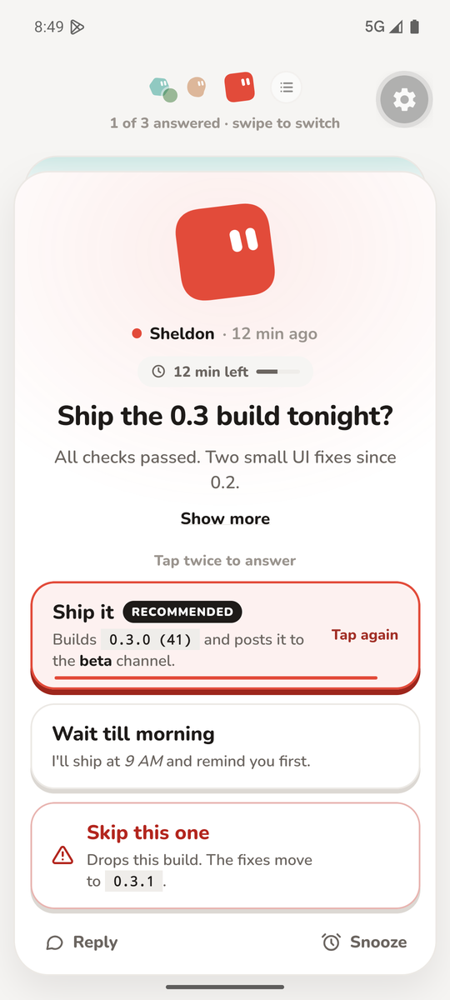
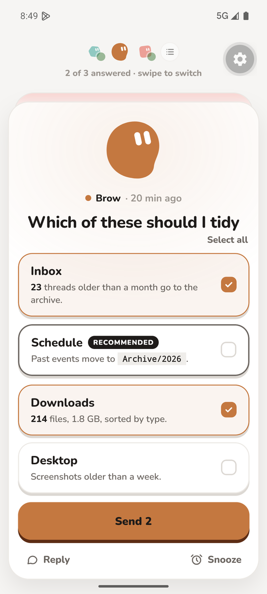
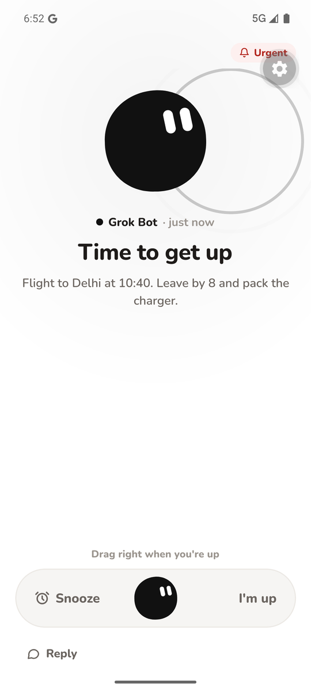

# Puck

[](https://github.com/ZeshanGIT/puck/actions/workflows/ci.yml)

Puck is a pager for AI agents: an agent sends an alert, your phone rings with a full-screen, call-style notification, and your reply goes back to the agent.

<p>
  
  
  
</p>

*Pick one (tap twice to send), pick several, and an urgent wake-up alarm you drag to answer. Screenshots from a development build on an Android emulator.*

## How it works

1. An agent pages you with the `puck` CLI or the HTTP API. The call returns at once with a question id.
2. Your Android phone shows a call-style alert. On Mac, Puck shows a floating reply card over your current app.
3. You answer deliberately: tap an option twice, check several and send, drag the bot past a line, or type a reply.
4. Puck posts the answer to that bot's own webhook, with stable option ids it can act on, and shows you when it was delivered.

Every bot pairs with a six-digit code you approve on the phone, and has its own key in each direction.

## Status

A personal project in active development, used daily on one Pixel 7. Puck for Mac is available as a local development build and uses the development backend. Test releases of the Android app and the `puck` CLI use a separate production backend.

## Try Puck (testers)

> The first test release is not published yet. These steps apply once it appears on the [Releases page](https://github.com/ZeshanGIT/puck/releases).

You need an Android phone (Android 7 or newer) and a Mac (Apple Silicon or Intel) or a Linux x64 machine for the CLI. Use the same Google account on both. While Puck is in testing, the owner has to add your Google account first, so send it to the owner before you start.

### 1. Install the Android app

1. On the phone, open the latest release on the [Releases page](https://github.com/ZeshanGIT/puck/releases) and download `puck-<version>.apk`.
2. Open the download. Android asks you to allow installs from your browser: allow it, go back and tap **Install**. Play Protect may warn about an app from an unknown developer; choose **Install anyway**.
3. Open Puck, tap **Continue with Google** and pick your account.
4. Allow notifications, and allow full-screen alerts when Puck asks, so urgent pages can ring over the lock screen. Onboarding ends with a test page; answer it.

To check the download, compare the APK's SHA-256 with the `SHA256SUMS` file in the same release (`shasum -a 256 puck-*.apk` on a Mac).

### 2. Install the CLI

```sh
curl -fsSL https://raw.githubusercontent.com/ZeshanGIT/puck/main/install.sh | sh
```

The script picks the binary for your machine, checks it against the release's `SHA256SUMS` and installs it as `~/.local/bin/puck`. If that folder is not on your `PATH`, it prints the line to add. Set `PUCK_INSTALL_DIR` to install somewhere else. Check it with `puck --version`.

To update, run the same command again. To uninstall, delete `~/.local/bin/puck` and `~/.config/puck/`.

### 3. Sign in, pair a bot, send a first alert

```sh
puck login                      # opens your browser; sign in with the same Google account as the phone
puck add testbot --no-webhook   # prints a six-digit code and a bot id such as testbot-12345
```

Your phone shows a pairing request with the same code. Check that the codes match and approve it. The CLI prints `approved`.

Then page yourself and wait for the answer (use the bot id that `puck add` printed):

```sh
printf '%s\n' '{"question":"Ship it?","priority":"normal","selectionMode":"single","options":[{"id":"yes","label":"Yes"},{"id":"no","label":"Not yet"}]}' |
  puck send --bot testbot-12345 --wait
```

The phone rings. Tap an option twice to answer, and the CLI prints your answer as JSON. Try `"priority":"urgent"` with the phone locked for the full-screen alert. `puck --help` lists the other commands; [CLI](#cli-cli) below has the details.

`--no-webhook` keeps the first run simple: answers are read back with `--wait` or `puck answer`. A real agent pairs with a webhook so Puck posts each answer to it.

## Testing and feedback

Thanks for trying Puck. Useful things to try:

- normal and urgent pages, with the phone unlocked, locked, and in Do Not Disturb;
- several options (`"selectionMode":"multi"`), a typed reply, snoozing, and a page scheduled with `--at`;
- leaving the phone idle for an hour or more, then paging it;
- signing out and back in, and pairing a second bot.

Report problems with the [bug report form](https://github.com/ZeshanGIT/puck/issues/new?template=bug_report.yml). Include the app version (Puck → Settings), `puck --version`, your phone model and Android version, and the steps that led to it. Never paste bot secrets, webhook URLs, auth headers or files from `~/.config/puck/`.

What is known not to work yet: there is no in-app update notice (check the Releases page), and the Mac app is not part of the test.

## Layout

A TypeScript monorepo managed with [Bun workspaces](https://bun.sh/docs/install/workspaces):

- `app/` (`@puck/app`) - mobile app in React Native with Expo (Android first)
- `desktop/` (`@puck/desktop`) - macOS app in Electrobun
- `backend/` (`@puck/backend`) - Convex backend: database and HTTP endpoints; Firebase Cloud Messaging is used only for push
- `cli/` (`@puck/cli`) - `puck` CLI in TypeScript (Commander, compiled to a single executable with `bun build --compile`)
- `packages/shared/` (`@puck/shared`) - alert and reply types shared by the app, backend and CLI
- `packages/client/` (`@puck/client`) - Convex client operations, registration, and reply rules used by Android and Mac. A separate loopback entry point shares system-browser sign-in with the CLI.
- `packages/appearance/` (`@puck/appearance`) - light and dark theme tokens, bot appearance, and avatar geometry shared by Android and Mac
- `tsconfig.base.json` - shared compiler options for the desktop app, CLI, and workspace packages

## Requirements

- [Bun](https://bun.sh) 1.4 or newer: `curl -fsSL https://bun.sh/install | bash`
- Node.js 22.13 or newer (LTS), needed by the Expo CLI
- For the app on Android: a development build (not Expo Go), the Android SDK, and JDK 17 for local Gradle builds

## Setup

```sh
bun install          # from the repo root; installs every workspace. Needs Bun 1.4 or newer (the lockfile version).
bun run typecheck    # typechecks all workspaces
bun test             # unit tests for hashing, validation and the answer payload
```

## Mac app (`desktop/`)

On macOS, install Bun and Xcode Command Line Tools, then run from the repo root:

```sh
bun install
bun run desktop:dev
```

Sign in using the same Google account as Android. Puck adds this Mac as a device. New alerts show in a floating card while Puck is running, even after you close the inbox window. The card opens without taking keyboard focus. Answer with options or text, snooze, or dismiss the card to return to it later in the inbox. Use **Puck → Quit Puck** or **⌘Q** to stop receiving alerts on the Mac.


- **Home** shows pending alerts, snoozed alerts, and live task progress.
- **Bots** shows paired bots for this account, pairing requests, and bot appearance and mute settings.
- **Archive** shows alert history, reply receipts, delivery retry, and finished task timelines.
- **Settings** has System, Light, and Dark themes, device management, and a test alert for this Mac. Replies can include files selected through the macOS picker.

`bun run desktop:build` writes a local, unsigned macOS app bundle under `desktop/build/`. Sign-in uses the development deployment by default.

## App (`app/`)

The app needs a **development build** (not Expo Go) because full-screen alerts will use native modules such as Notifee later. Phase 1 adds `expo-dev-client` and the Android application id `in.puckit.app`.

### Requirements on your machine

- Node.js 22.13 or newer (LTS)
- Android SDK at `$HOME/Library/Android/sdk` (Android Studio)
- JDK 17 for Gradle (the app `start` script exports `JAVA_HOME` from `/usr/libexec/java_home -v 17`; it does not change your system Java default)

### Local Android build (no device required)

From the repo root:

```sh
~/.bun/bin/bun install
cd app
~/.bun/bin/bunx expo prebuild --platform android --no-install
export JAVA_HOME="$(/usr/libexec/java_home -v 17)"
export ANDROID_HOME="$HOME/Library/Android/sdk"
cd android
./gradlew :app:assembleDebug
```

Prebuild writes `app/android/` locally (gitignored). A successful `assembleDebug` produces a debug APK under `app/android/app/build/outputs/apk/debug/`.

### Release APK on the Pixel 7 (one command)

Connect the Pixel 7 over wireless debugging or USB, unlock it, and accept the debugging prompt. Then, from the repo root:

```sh
bun run release:install
```

The script checks JDK 17, the Android SDK and the phone before it builds. Then it:

1. runs `expo prebuild` for Android, which regenerates `app/android` from `app.json` and the config plugins;
2. runs `./gradlew :app:assembleRelease -PreactNativeArchitectures=arm64-v8a`, with R8 on and the JavaScript bundle embedded;
3. checks the APK: the package name, not debuggable, the bundle present, and the WorkManager keep rules in the R8 mapping;
4. runs `adb install -r` on the phone, which keeps the app's data, and prints the package metadata.

It does not launch the app or change device settings.

Options (after `--`):

- `bun run release:install -- --serial <serial>` picks the phone when more than one is connected. `PUCK_ADB_SERIAL` does the same. Find serials with `adb devices -l`.
- `bun run release:install -- --dry-run` checks everything and prints the plan. Nothing is built or installed.
- `bun run release:install -- --skip-build` installs the APK already built.
- `PUCK_DEVICE_MODEL` sets the expected model (default `Pixel 7`); set it to an empty string to skip the check.

Safety: emulators are refused. A phone that is not authorized, or several phones without `--serial`, stop the script with a message. The phone's model must match. Install is `adb install -r` only: no uninstall, no data clear, no downgrade. If the signing key differs from the installed app, install fails and nothing is removed.

Requirements: JDK 17 (`/usr/libexec/java_home -v 17` on macOS, or `JAVA_HOME`), the Android SDK (`ANDROID_HOME`, default `~/Library/Android/sdk` on macOS), Node 22.13 or newer, and `unzip`. The release is signed with the debug keystore and points at the dev Convex and Clerk instances, so it is not a store build. Tester builds come from `bun run release:build` (see [Test releases](#test-releases-maintainers)).

### Run on a device or emulator (development build)

When you have a connected device or a working emulator:

```sh
cd app
~/.bun/bin/bun run android
```

The `start` and `android` scripts export `JAVA_HOME` and `ANDROID_HOME` before calling Expo. With the dev client installed, `~/.bun/bin/bun run start` runs Metro for JavaScript hot reload.

Add native-compatible packages with `bunx expo install <package>` so versions match the Expo SDK. Metro resolves workspace packages such as `@puck/shared` automatically; no custom Metro config is needed.

## Test releases (maintainers)

Test releases are built by hand on a Mac and published to GitHub Releases. Two **build profiles** in `config/profiles.json` decide which backend a build talks to:

| | `dev` | `prod` |
| --- | --- | --- |
| Convex | `usable-mule-44` | the production deployment |
| Clerk | `in-lemming-9901.clerk.accounts.dev` | the same instance for now |
| Who uses it | local and Pixel builds, `bun run dev` CLI | testers: the released APK and CLI binaries |

The profile is chosen explicitly at build time, never by editing code:

- **App:** `EXPO_PUBLIC_PUCK_PROFILE=prod` turns on production rules. A production bundle must set `EXPO_PUBLIC_CONVEX_URL`, `EXPO_PUBLIC_CONVEX_SITE_URL`, `EXPO_PUBLIC_CLERK_FRONTEND_API` and `EXPO_PUBLIC_CLERK_GOOGLE_WEB_CLIENT_ID`, and must not point at the dev deployment; otherwise the app stops at launch instead of falling back to dev (`app/src/buildProfile.ts`). Without the variable a build is `dev`, as before, so `bun run release:install` and Metro are unchanged.
- **CLI:** a release binary bakes in its profile's deployment and Clerk host (`cli/src/build.ts`). `PUCK_DEPLOYMENT_URL` and `~/.config/puck/config.json` still win over it, so a machine set up for dev stays on dev. `puck --version` prints the profile, such as `1.0.0+abc1234 (prod)`. A source run (`bun run dev`) has no built-in deployment.

### Build

```sh
bun run release:build -- --profile prod --dry-run   # check inputs, print the plan
bun run release:build -- --profile prod             # build everything into dist/release/<tag>/
```

The script needs a clean tree (committed changes only), then:

1. runs `expo prebuild --clean` and `assembleRelease` with the profile's `EXPO_PUBLIC_*` values, for `arm64-v8a` and `armeabi-v7a` in one APK. `versionCode` is 1000 plus the commit count, and `versionName` is `<app.json version>+<short sha>`;
2. checks the APK: package `in.puckit.app`, not debuggable, `targetSdkVersion` 36 or higher, both ABIs, the versions, the WorkManager keep rules, the profile's Convex and Clerk hosts inside the JavaScript bundle, and, for `prod`, a signature by the release key (never the debug key);
3. compiles the CLI for `darwin-arm64`, `darwin-x64` and `linux-x64` with the profile baked in, and checks `--version`;
4. writes `SHA256SUMS` and `notes.md`. Nothing is published.

`--skip-app` and `--skip-cli` build one half. The Google web client ID comes from `EXPO_PUBLIC_CLERK_GOOGLE_WEB_CLIENT_ID` or `app/.env.local`.

**Signing.** A `prod` build requires the release keystore. `app/plugins/withReleaseSigning.js` makes Gradle read it from the environment at build time, so no path or password is written into `app/android/`. Without `PUCK_KEYSTORE_PATH`, release builds keep the debug key. `release:build` reads:

- `PUCK_KEYSTORE_PATH`, default `~/.config/puck/release.keystore`;
- `PUCK_KEYSTORE_PASSWORD_FILE`, default `~/.config/puck/release.keystore.pass` (one line, mode 600);
- `PUCK_KEY_ALIAS`, default `puck`.

The keystore never goes in a repo. Back it up in two places: losing it means testers can't update in place. A release-signed APK cannot install over a debug-signed one, so a phone moving between them has to uninstall first, which clears the app's data.

### Publish

After the commit is on `origin/main`, and only with the owner's go-ahead:

```sh
scripts/publish-release.sh v1.0.0-build.1180
```

It checks the build's commit is on `origin/main` and the checksums match, then creates the GitHub release, marked latest, with the APK, the CLI binaries and `SHA256SUMS`. `install.sh` downloads from the latest release.

## Backend (`backend/`)

The Convex project stores bots, alerts and answers (`convex/schema.ts`) and serves `GET /health`, `POST /alerts` and `GET /alerts/<questionId>`. The dev deployment is `usable-mule-44` (team `sthx-sthx`, project `puck`): the client URL is `https://usable-mule-44.convex.cloud` and HTTP actions are at `https://usable-mule-44.convex.site`. `convex/http.ts` uses the generated `httpAction`, and internal calls use `internal` from `convex/_generated/api`.

`POST /alerts` and `GET /alerts/<questionId>` authenticate with the headers `X-Puck-Bot-Id` (the public id, such as `sheldon-23648`) and `Authorization: Bearer <secret>`. The secret is hashed and compared with `bots.secretHash`. A paired bot's `POST /alerts` returns `{ "questionId": "q_..." }` immediately. The body is a question, `priority` (`normal` or `urgent`), `selectionMode` (`single` or `multi`) and `options` (`id`, `label`, optional `icon`).

Recording a reply is the public mutation `answers.record`. It stores the answer and schedules an action that POSTs the answer payload to that bot's webhook, with the stored Authorization header, retrying up to four times (immediately, then after 1s, 4s and 16s).

Pairing is stubbed as the mutations `bots.createPairing` and `bots.approvePairing`. `createPairing` returns the bot id, the secret (once) and a six-digit code. It stores a hash of the secret and an encrypted webhook header. The CLI and app do not call these yet.

`PUCK_ENCRYPTION_KEY` is set on the dev deployment. It is 32 bytes of base64. Do not print it or commit it. `backend/.env.local` is git-ignored.

Push function changes with:

```sh
cd backend
bunx convex dev --once
```

Check the health route:

```sh
curl https://usable-mule-44.convex.site/health
```

## CLI (`cli/`)

```sh
cd cli
bun run dev --help       # run from source
bun run build            # compile to cli/bin/puck (git-ignored)
./bin/puck --version
```

### Page a bot

Use the same alert JSON as `puck send`, via stdin or `--file`. The title is `question`, and the optional body is `message`.

```sh
printf '%s\n' '{"question":"Ship this build?","message":"All checks passed.","priority":"normal","selectionMode":"single","options":[{"id":"ship","label":"Ship"},{"id":"hold","label":"Hold"}],"replyTo":"your-t3-thread-id"}' |
  puck send --bot sender-12345 --to receiver-23456
```

The sender and receiver must be paired from a signed-in CLI on the same account, and the receiver needs a webhook. The CLI prints the alert ID when Convex queues the webhook. The page does not create a phone alert. Include `replyTo` to request an out-of-band reply, for example via `t3 thread send <replyTo>`. Puck passes the string through unchanged. Omit it for an FYI. A bare `{"message":"..."}` is no longer accepted. Targeted alerts reject `--wait`, `--timeout`, `--at`, `--through-snooze`, and scheduling or snoozing fields.

The receiver gets a webhook with `event: "bot_alert"`, `alertId`, `sender: { id, name }`, the validated alert in `alert`, optional `replyTo`, and an ISO UTC `sentAt`. Verify the configured Authorization header and return a 2xx response. Puck makes up to four delivery attempts. Deduplicate ordinary alerts by `alertId`.

For live activities, pass the same `--to` on each existing status command.

```sh
puck status start --bot sender-12345 --to receiver-23456 --title "Build" --steps "Compile|Test"
puck status step Test --bot sender-12345 --to receiver-23456
puck status note "All checks passed" --bot sender-12345 --to receiver-23456
puck status end --bot sender-12345 --to receiver-23456
```

Every accepted status command queues one webhook with the same activity `alertId` and an `activity` snapshot containing its title, state, track, note, link, update time, command action and increasing `sequence`. Use `(alertId, activity.sequence)` to deduplicate retries and handle out-of-order delivery. Each sender and receiver pair has its own activity. A new start replaces it, and it must be restarted after 30 minutes without updates. Targeted alerts and live updates share a per-sender allowance of 12 pages, replenished at one page per five seconds.

### Check an answer: `puck answer`

```sh
puck answer <alert-id> [--bot <bot-id>] [--json]
```

Reads one alert of that bot (`GET /alerts/<id>`, bot-secret auth) and prints the reply the person gave, so an agent can confirm a reply reached Puck. Output:

```text
q_01HV7K3M2ZABCDEF  answered  Ship it?
answer: Yes (yes)
reply: go ahead                      # only with a typed reply
answered: 2026-11-09 14:05
delivery: delivered (1 attempt)      # webhook delivery; an `error:` line follows when it failed
```

Without an answer it prints `no answer yet`, `snoozed, no answer yet` or `cancelled` under the first line. `--json` prints the validated alert and answer as JSON. `puck list` now also lists snoozed alerts.
