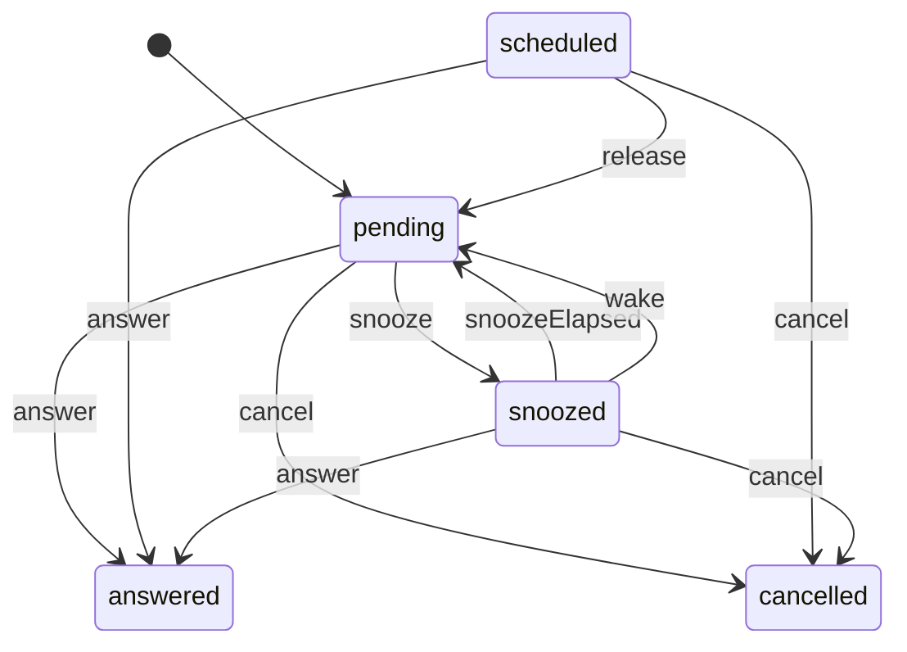
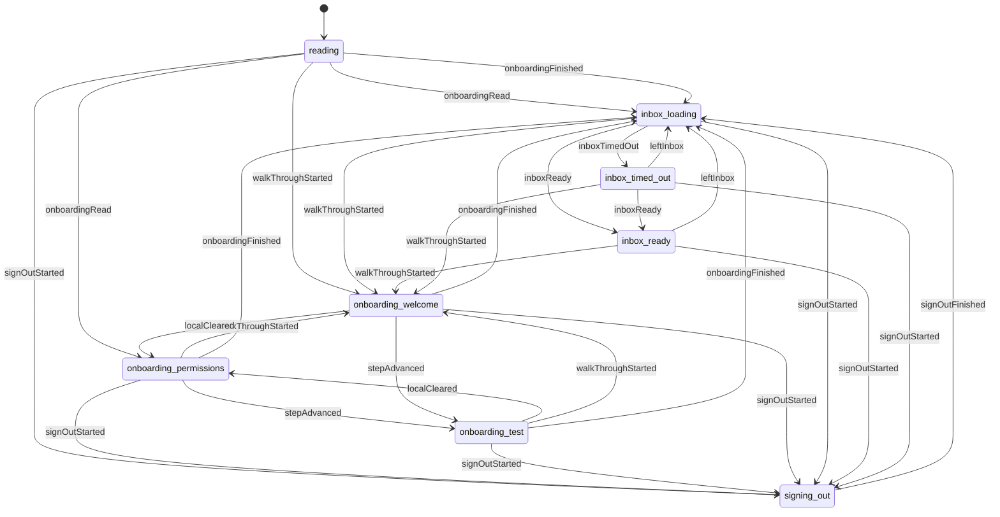
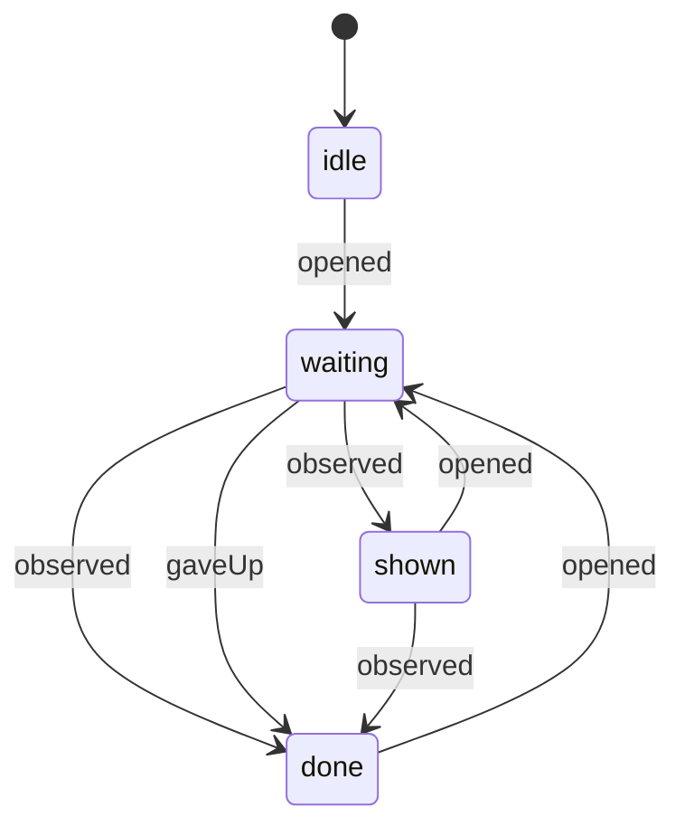
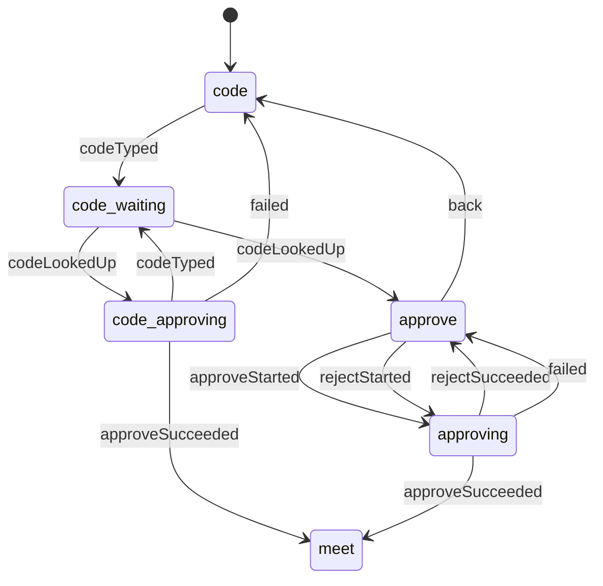
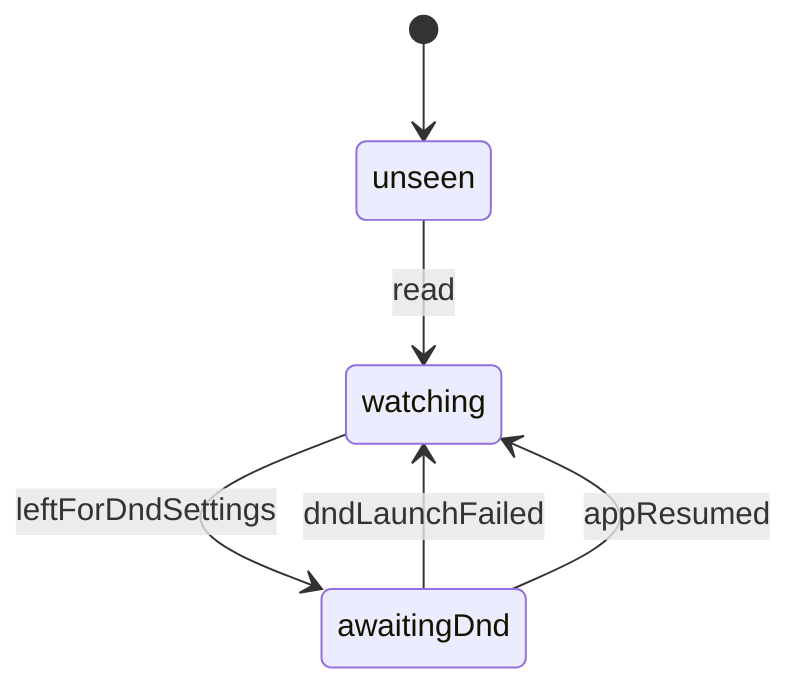
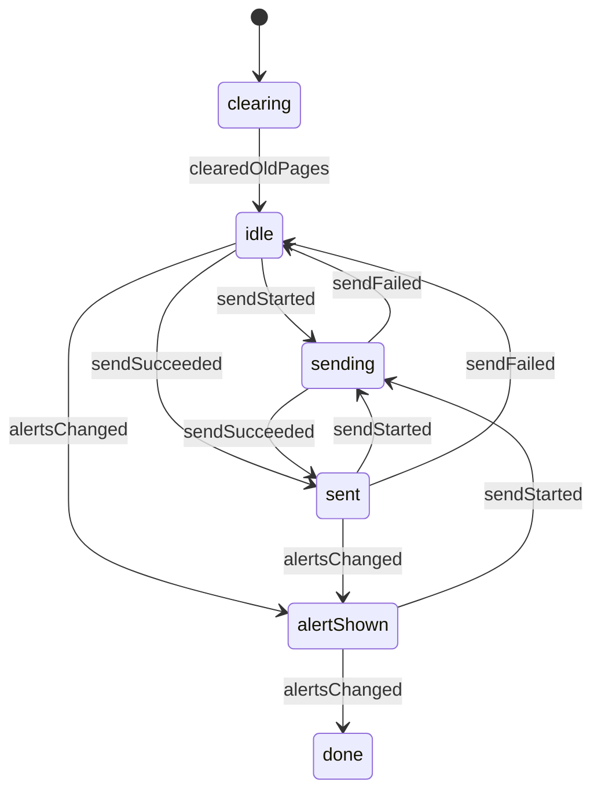

# State machines

Puck's flows with more than one moving part are explicit machines: one state type, one pure `transition(state, event)`, no React and no I/O inside. Components and Convex mutations turn what happened into an event, call the transition, and render or persist the result. This page is the map for people and agents.

## The convention

- A machine lives in a `*Machine.ts` file (`app/src/`) or beside the shared model (`packages/shared/src/`), and is built with `defineMachine` from `@puck/shared` (`packages/shared/src/machine.ts`).
- It declares: `name`, `summary`, `usedBy`, `initial`, `transition`, `label` (the control phase, used for diagrams), an `invariant` (impossible states) and `samples` (one state per phase, one event per type, JSON only).
- Effects a transition wants (toasts, writes, timers) are returned as data in the state, and the component performs them. The transition never does I/O.
- Register it in `app/src/machines.ts` (or `packages/shared/src/machines.ts`). `app/src/machines.test.ts` fails if a `*Machine.ts` file is not registered, and runs `checkMachine` on every machine: no throw, no input mutation, deterministic, invariant holds after every sample state meets every sample event.
- Regenerate the tables below with `bun run machines:doc`; `bun run machines:check` fails when they are stale.
- A new flow that has two or more flags which must agree is a machine. Write the transition first, test it, then wire the screen.

## Inventory (what the 2026-11-09 audit found)

Done in this pass (see the generated sections below):

| Machine | Was | Fixed on the way |
| --- | --- | --- |
| alert-lifecycle | status patched in about a dozen places with separate guards | one decision table; error text and behaviour unchanged |
| app-session | 7 `useState`s in `AppBody` | `freshSignIn` and the inbox cover latches no longer stick across sessions; the 4 s timer no longer runs during sign-out |
| alert-launch | `openedId` only overwritten, never cleared | a later alert takes over after the opened one is done; no permanent blank screen when the deck keeps a launched alert off |
| pairing-flow | step, error, busy, typed, a ref | same behaviour, testable; three quirks documented, not changed |
| permissions-check | a `previous` ref diffing readings | the diff and its effects are a pure function |
| test-page | flags plus a `sawAlert` ref | same behaviour; the "any alert finishes the step" weakness is documented |

Also fixed without a machine: the live "Working now" ended card timer is no longer cancelled when the running list changes again (`useLiveActivities.ts`), which left a finished card on Home until restart.

Still implicit, in priority order (nothing here was changed, on purpose):

1. **Answer attempt** (idle, unlocking, sending, queued, sent, failed) is copied across `A1ChoiceSingle`, `A2ChoiceMulti`, `A3Swipe`, `StackCard`, `AlertHost` and `StackHost`. Known defect: a queued answer that the flush drops (permanent error, expired, too many failures) leaves the queue without `onSent`, and the 500 ms poll reads "not in the queue" as "sent", so the receipt says Sent for an answer that never went. Fixing it changes what the person sees (the answer was rejected, so say so), which is a product decision. Design: one shared reducer with an explicit "queue item left (sent or dropped)" event replacing the poll.
2. **Client session** (`useClientSession`, `useClerkAccount`): `resolve()` has no live guard, so a late registration can write `ready` for a signed-out account; a cold start offline shows O1 instead of the inbox; registering is not idempotent when the response is lost; no timeout on the pending token.
3. **Ring lifecycle** (`urgentDisplay.ts`, `speak.ts`, native `OverlayCard.kt`): a clear that lands during the awaits in `startRinging` finds no ring, so the ring posts anyway. The overlay card has no "committed" state, so a tap during the 150 ms exit animation can open the app twice. Both files were being edited by another agent on 2026-11-09; coordinate first.
4. **A8 stack navigation** (`AStack.tsx`): `scheduleAdvance` moves the front 700 ms after a send even when the send fails.
5. **A5 reply sheet**, **SwipeTrack**, **delivery of answers vs snooze events** (`delivery.ts` repeats the same begin/complete/fail machine for `answers` and `snoozeEvents`), **bot pairing and live activity status writes** (backend, already guarded by pure helpers).

<!-- machines:start (generated by bun run machines:doc, do not edit by hand) -->

## Shared (packages/shared)

### alert-lifecycle

Stored status of one alert: scheduled, pending, snoozed, answered, cancelled. Every status write in the backend asks decideAlert first.

Used by: `backend/convex/alerts.ts`, `backend/convex/answers.ts`, `backend/convex/bots.ts`, `packages/shared/src/schedule.ts`, `packages/shared/src/model.ts`

Events: `answer`, `snooze`, `release`, `snoozeElapsed`, `wake`, `cancel`

| From | Event | To |
| --- | --- | --- |
| pending | answer | answered |
| pending | snooze | snoozed |
| pending | cancel | cancelled |
| scheduled | answer | answered |
| scheduled | release | pending |
| scheduled | cancel | cancelled |
| snoozed | answer | answered |
| snoozed | snoozeElapsed | pending |
| snoozed | wake | pending |
| snoozed | cancel | cancelled |

## App (app/src)

### app-session

Local session flags of the app root: onboarding progress, the fresh sign-in latch, sign-out in progress and the opening cover over the inbox.

Used by: `app/App.tsx`, `app/src/accountGate.ts`, `app/src/startupGate.ts`

Events: `onboardingRead`, `devWalkthroughRead`, `signInStarted`, `signInFailed`, `registrationReady`, `leftInbox`, `signOutStarted`, `localCleared`, `signOutFinished`, `walkThroughStarted`, `stepAdvanced`, `onboardingFinished`, `inboxReady`, `inboxTimedOut`

| From | Event | To |
| --- | --- | --- |
| reading | onboardingRead | inbox_loading |
| reading | onboardingRead | onboarding_permissions |
| reading | signOutStarted | signing_out |
| reading | walkThroughStarted | onboarding_welcome |
| reading | onboardingFinished | inbox_loading |
| onboarding_permissions | signOutStarted | signing_out |
| onboarding_permissions | walkThroughStarted | onboarding_welcome |
| onboarding_permissions | stepAdvanced | onboarding_test |
| onboarding_permissions | onboardingFinished | inbox_loading |
| onboarding_test | signOutStarted | signing_out |
| onboarding_test | localCleared | onboarding_permissions |
| onboarding_test | walkThroughStarted | onboarding_welcome |
| onboarding_test | onboardingFinished | inbox_loading |
| onboarding_welcome | signOutStarted | signing_out |
| onboarding_welcome | localCleared | onboarding_permissions |
| onboarding_welcome | stepAdvanced | onboarding_test |
| onboarding_welcome | onboardingFinished | inbox_loading |
| inbox_loading | signOutStarted | signing_out |
| inbox_loading | walkThroughStarted | onboarding_welcome |
| inbox_loading | inboxReady | inbox_ready |
| inbox_loading | inboxTimedOut | inbox_timed_out |
| inbox_ready | leftInbox | inbox_loading |
| inbox_ready | signOutStarted | signing_out |
| inbox_ready | walkThroughStarted | onboarding_welcome |
| inbox_timed_out | leftInbox | inbox_loading |
| inbox_timed_out | signOutStarted | signing_out |
| inbox_timed_out | walkThroughStarted | onboarding_welcome |
| inbox_timed_out | inboxReady | inbox_ready |
| signing_out | signOutFinished | inbox_loading |

### alert-launch

The alert a notification or the compact card opened: preferred while it loads and shows, then released so normal routing resumes.

Used by: `app/src/Inbox.tsx`, `app/src/alertLaunchRouting.ts`, `app/src/push.ts`

Events: `opened`, `observed`, `gaveUp`

| From | Event | To |
| --- | --- | --- |
| idle | opened | waiting |
| waiting | observed | shown |
| waiting | observed | done |
| waiting | gaveUp | done |
| shown | opened | waiting |
| shown | observed | done |
| done | opened | waiting |

### pairing-flow

J2 pairing screens: B3 keypad (a typed code may wait for the request list), B4 approve or reject, B5 meet. Holds the screen, the error line and whether an approve or reject is in flight.

Used by: `app/src/screens/PairingHost.tsx`

Events: `codeTyped`, `codeEdited`, `codeLookedUp`, `approveStarted`, `rejectStarted`, `approveSucceeded`, `rejectSucceeded`, `failed`, `back`

| From | Event | To |
| --- | --- | --- |
| code | codeTyped | code-waiting |
| code-waiting | codeLookedUp | approve |
| code-waiting | codeLookedUp | code-approving |
| code-approving | codeTyped | code-waiting |
| code-approving | approveSucceeded | meet |
| code-approving | failed | code |
| approve | approveStarted | approving |
| approve | rejectStarted | approving |
| approve | back | code |
| approving | approveSucceeded | meet |
| approving | rejectSucceeded | approve |
| approving | failed | approve |

### permissions-check

O2 permissions screen: remembers the last reading of notifications, full-screen and Do Not Disturb, and turns each change into toasts and client flag syncs.

Used by: `app/src/screens/O2Permissions.tsx`

Events: `read`, `leftForDndSettings`, `dndLaunchFailed`, `appResumed`

| From | Event | To |
| --- | --- | --- |
| unseen | read | watching |
| watching | leftForDndSettings | awaitingDnd |
| awaitingDnd | dndLaunchFailed | watching |
| awaitingDnd | appResumed | watching |

### test-page

O3 test page: sending the urgent test alert, its error, and when the step is done (an alert that was on screen has left pending).

Used by: `app/src/screens/O3TestPage.tsx`

Events: `clearedOldPages`, `sendStarted`, `sendSucceeded`, `sendFailed`, `alertsChanged`

| From | Event | To |
| --- | --- | --- |
| clearing | clearedOldPages | idle |
| idle | sendStarted | sending |
| idle | sendSucceeded | sent |
| idle | alertsChanged | alertShown |
| sending | sendSucceeded | sent |
| sending | sendFailed | idle |
| sent | sendStarted | sending |
| sent | sendFailed | idle |
| sent | alertsChanged | alertShown |
| alertShown | sendStarted | sending |
| alertShown | alertsChanged | done |

<!-- machines:end -->
